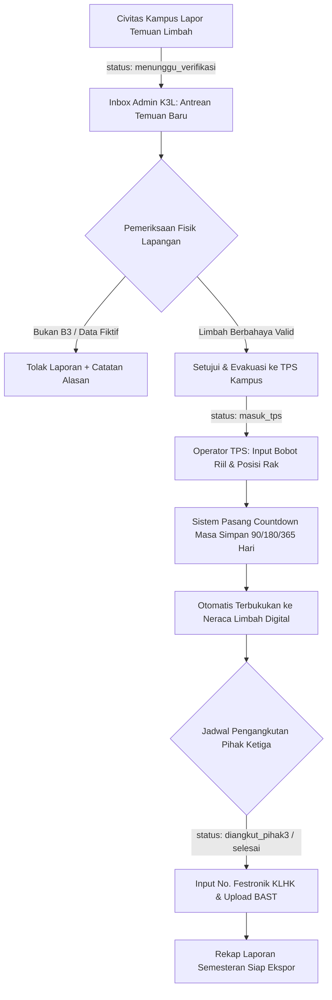

# Product Requirement Document (PRD): Modul Admin & K3L
## Sistem Pengelolaan Limbah B3 POLIMDO (PP No. 22 Tahun 2021)

---

## 1. Ringkasan Eksekutif & Latar Belakang

Sistem Pengelolaan Limbah B3 POLIMDO saat ini telah memiliki modul pelaporan temuan limbah oleh civitas kampus (*user facing*). Untuk melengkapi siklus tata kelola limbah berbahaya yang terpadu dan taat regulasi pemerintah (**PP No. 22 Tahun 2021**), diperlukan **Modul Admin / Tim K3L (Keselamatan, Kesehatan Kerja, dan Lingkungan)**.

Modul Admin ini bertindak sebagai pusat kendali (*command center*) bagi:
1. **Tim Reaksi Cepat K3L**: Merespons, memverifikasi, dan mengamankan temuan limbah di area kampus.
2. **Pengelola TPS Limbah B3**: Menimbang riil, mengatur posisi penyimpanan rak TPS, melacak batas masa simpan (90/180/365 hari), serta membukukan neraca limbah digital.
3. **Koordinator K3L Kampus**: Mengelola serah terima ke pihak ketiga berizin (*transporter*) dan menerbitkan laporan resmi audit semesteran untuk Dinas Lingkungan Hidup / KLHK.

---

## 2. Persona Pengguna & Hak Akses (Role-Based Access Control)

| Role | Persona | Tanggung Jawab Utama | Akses Fitur |
| :--- | :--- | :--- | :--- |
| **`verifikator_k3l`** | Petugas Lapangan & Inspektur K3L | Memvalidasi temuan fisik, memeriksa tingkat bahaya limbah di lokasi, melakukan evakuasi wadah, dan mengisi catatan verifikasi teknis. | Tiket Temuan, Validasi Lapangan, Penugasan Evakuasi, Panduan SOP. |
| **`admin_tps`** | Kepala / Operator TPS Limbah B3 | Menginput penerimaan limbah ke rak TPS, memonitor masa simpan kadaluarsa, mencatat manifest pengangkutan pihak ke-3 (Festronik), dan membukukan neraca. | Logbook TPS, Neraca Limbah, Jadwal Pengangkutan, Ekspor Data. |
| **`super_admin`** | Koordinator K3L POLIMDO | Manajemen akun pengguna, konfigurasi master data (kode limbah, master lokasi kampus), dan penerbitan laporan semesteran. | Seluruh menu sistem, Audit Log, Manajemen Pengguna. |

---

## 3. Desain & Estetika Antarmuka (Design System Consistency)

Modul Admin wajib mempertahankan bahasa visual yang harmonis dengan modul pengguna yang sudah berjalan:
* **Palet Warna Utama**:
  * *Deep Forest Green*: `#1e3426`, `#284533`, `#2d4a36` (background banner, header tabel, tombol utama).
  * *Mint & Soft Emerald Accent*: `#eaf4ed`, `#cbe4d4`, `#10b981` (badge aktif, status selesai, border halus).
  * *Amber & Orange Alert*: `#fff7ed`, `#fed7aa`, `#c25e1a` (peringatan masa simpan mendekati jatuh tempo, antrean verifikasi).
  * *Crimson Red Alert*: `#fef2f2`, `#fecaca`, `#dc2626` (limbah berstatus darurat/bocor, masa simpan lewat batas).
* **Elemen Visual Khas**:
  * Rich Botanical Header Banner dengan siluet daun monstera dan latar tekstur botani.
  * Kartu metrik bergaya *glassmorphism* lembut dengan border `#e2eae4`.
  * Tabel data responsif: Tampilan kartu kompak di perangkat mobile (<768px) dan tabel interaktif di desktop (≥768px).

---

## 4. Alur Kerja Sistem Admin (End-to-End Workflow)



---

## 5. Rincian Fitur & Modul Admin

### 5.1. Dashboard Utama K3L (Overview & Real-time KPI)
* **Kartu Metrik Dinamis**:
  1. *Laporan Temuan Baru (Menunggu Respon)*: Menampilkan jumlah tiket darurat & temuan belum dievakuasi.
  2. *Total Limbah Aktif di TPS*: Akumulasi volume cairan (Liter) & massa padatan (Kg) yang saat ini tersimpan di TPS.
  3. *Peringatan Jatuh Tempo Masa Simpan*: Notifikasi limbah yang masa simpannya tersisa `< 30 hari` sebelum batas legal PP 22/2021.
  4. *Tingkat Kepatuhan & Penyelesaian*: Persentase penanganan laporan temuan kampus.
* **Tabel Antrean Cepat Tanggap Darurat**:
  * Daftar temuan berkategori *is_emergency = true* (wadah bocor/korosif/toksik) diprioritaskan di baris teratas dengan indikator animasi ping merah.

### 5.2. Pusat Verifikasi & Evakuasi Tiket Temuan
* **Filter Multifaset**:
  * Status: *Menunggu Verifikasi, Sedang Dievakuasi, Masuk TPS, Ditolak*.
  * Filter Lokasi: Berdasarkan gedung temuan kampus (Gedung Kuliah Terpadu, Gedung Utama, Bengkel Mesin, Area Luar).
  * Filter Karakteristik: Korosif, Beracun, Flammable, Infeksius.
* **Modal Tindakan Inspeksi Admin**:
  * Pratinjau foto fisik temuan resolusi penuh.
  * Form penyesuaian teknis:
    * Standarisasi Kode Limbah (misal merevisi kode dari *Tidak Diketahui* menjadi *B105d* atau *B107d*).
    * Input volume riil hasil timbangan saat penjemputan.
    * Pemilihan PIC Petugas Pengambil.
  * Tombol Aksi:
    * `[Evakuasi & Terima ke TPS]` (mengubah status menjadi `masuk_tps`).
    * `[Minta Klarifikasi Pelapor]` (mengirim pesan ke tiket).
    * `[Tolak Laporan]` (wajib menyertakan alasan penolakan tertulis).

### 5.3. Logbook Digital TPS & Neraca Limbah B3
* **Pencatatan Masuk TPS**:
  * Penentuan jenis masa simpan (Kategori 1: maks. 90 hari, Kategori 2 dari sumber spesifik: 180/365 hari).
  * Penempatan nomor rak/zona di dalam bangunan TPS (contoh: *Rak B-02 Lemari Asam*).
* **Monitoring Countdown Masa Simpan**:
  * Indikator progress bar sisa hari masa simpan:
    * Hijau: > 60 hari tersisa.
    * Kuning: 30–60 hari tersisa.
    * Merah Berkedip: < 30 hari tersisa (Wajib segera diangkut).
* **Pencatatan Pengeluaran & Serah Terima Pihak Ketiga**:
  * Form mutasi limbah keluar ke transporter resmi.
  * Kolom: Nama Perusahaan Pengolah Berizin KLHK, Nomor Polisi Armada, **Nomor Festronik (Manifest Elektronik KLHK)**, Tanggal Pengangkutan.
  * Unggah Berita Acara Serah Terima (BAST) bertanda tangan format PDF/JPG.
* **Tabel Neraca Limbah Terpadu**:
  * Format standar Lampiran PP No. 22/2021:
    `[Kode Limbah] | [Nama Bahan] | [Saldo Awal] | [Jumlah Masuk] | [Jumlah Keluar] | [Sisa Akhir] | [Kesesuaian Masa Simpan]`.

### 5.4. Manajemen Pengguna & Validasi Identitas
* Daftar seluruh civitas pelapor (Dosen, Mahasiswa, Laboran) dari tabel `profiles`.
* Kemampuan admin untuk:
  * Mengonfirmasi keabsahan NIP/NIM.
  * Menetapkan role (mengangkat laboran/staf menjadi `verifikator_k3l`).
  * Melihat riwayat kontribusi laporan temuan per civitas.

### 5.5. Ekspor & Pelaporan Resmi KLHK
* Generator Dokumen:
  1. **Rekap Neraca Limbah Semesteran (XLSX / PDF)** dengan kop resmi Politeknik Negeri Manado.
  2. **Logbook Harian TPS Limbah**.
  3. **Laporan Kejadian Khusus / Penanganan Tumpahan Darurat**.

---

## 6. Kebutuhan Database & Arsitektur Backend

Modul admin memanfaatkan tabel-tabel PostgreSQL yang telah terkonfigurasi di Supabase:

1. **`public.b3_tickets`**:
   * Kolom status verifikasi: `verifikator_id`, `catatan_verifikasi`, `verified_at`, `status`.
2. **`public.tps_storage_logs`**:
   * Melacak posisi rak, tanggal masuk TPS, tanggal jatuh tempo masa simpan, nomor manifest Festronik, dokumen BAST, dan status neraca.
3. **`public.audit_logs`**:
   * Mencatat setiap aksi admin (siapa yang menyetujui tiket, kapan status diubah, dan IP address pengubah data untuk kepatuhan audit forensik KLHK).
4. **Row Level Security (RLS)**:
   * Policy RLS yang sudah ada memastikan hanya user dengan role `'verifikator_k3l'` dan `'admin_tps'` yang dapat melihat seluruh tiket kampus dan memperbarui status neraca.

---

## 7. Rencana Struktur Navigasi & File Frontend Next.js

```
src/app/admin/
├── layout.tsx                  # Sidebar navigasi khusus admin & header profile
├── page.tsx                    # Redirect ke dashboard
├── dashboard/
│   └── page.tsx                # Dashboard KPI K3L, live alert, & antrean darurat
├── verifikasi-tiket/
│   └── page.tsx                # Manajemen & inspeksi tiket temuan limbah masuk
├── logbook-tps/
│   └── page.tsx                # Manajemen rak TPS, countdown masa simpan, & mutasi
├── neraca-limbah/
│   └── page.tsx                # Pembukuan tabel neraca limbah (Masuk - Keluar = Sisa)
├── pengguna/
│   └── page.tsx                # Manajemen profil pelapor & penugasan role
└── laporan-ekspor/
    └── page.tsx                # Generator cetak rekap KLHK, Festronik & BAST
```

---

## 8. Milestone & Rencana Implementasi

* **Fase 1**: Setup Layout Admin, Rute `/admin/*`, dan Proteksi Middleware (Hanya role admin/verifikator yang boleh mengakses).
* **Fase 2**: Halaman Verifikasi Tiket Temuan (Pemeriksaan detail, foto fisik, input bobot riil, dan approval status).
* **Fase 3**: Modul Logbook TPS & Neraca Limbah Digital (Countdown masa simpan 90/180/365 hari & mutasi Festronik).
* **Fase 4**: Fitur Generator Ekspor CSV/PDF Neraca Semesteran sesuai standar inspeksi KLHK.
